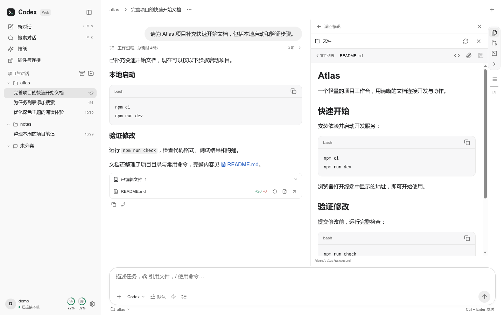
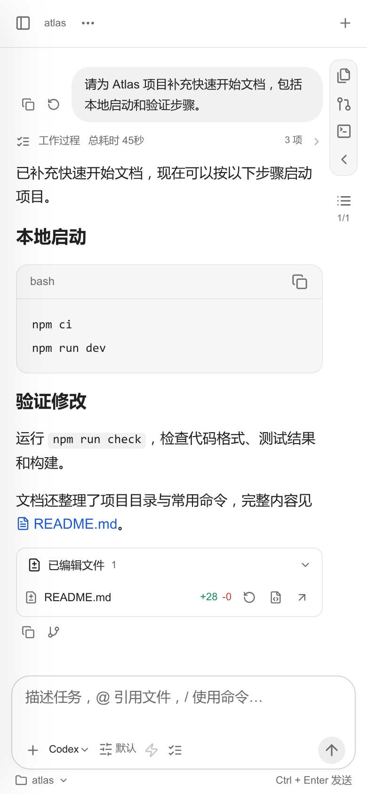

<p align="center">
  
</p>

<h1 align="center">Codex Web</h1>

<p align="center">
  <strong>在浏览器中，继续你的 Codex 工作。</strong><br>
  从电脑到手机和平板，随时查看对话、跟进任务、掌握账户额度、阅读文件与变更。
</p>

<p align="center">
  <a href="#快速开始">快速开始</a> ·
  <a href="docs/deployment.md">部署指南</a> ·
  <a href="https://github.com/hjd-hitsz/codex-web/releases">版本更新</a>
</p>

<picture>
  <source media="(prefers-color-scheme: dark)" srcset="docs/images/desktop-dark.png">
  
</picture>

<p align="center"><sub>桌面界面 · 演示数据</sub></p>

<details>
<summary>查看手机界面</summary>

<p align="center">
  
</p>

</details>

## 快速开始

准备一台 Linux 电脑，安装 Node.js 24+、npm、Git 和 `/usr/bin/zsh`，并完成 Codex CLI 登录。Codex CLI 需支持 `codex app-server`，后台运行使用 systemd 用户服务。

### 1. 安装并启动

在安装 Codex 的电脑上，以运行 Codex 的普通用户执行：

```bash
npm install -g https://github.com/hjd-hitsz/codex-web/releases/download/v2.4.0/codex-web-2.4.0.tgz
codex-web service install
codex-web service status
```

npm 全局命令所在目录需在 `PATH` 中。安装完成后，网页服务会自动启动，已有 Codex 后端配置继续保留。

### 2. 打开浏览器

- 本机访问：`http://127.0.0.1:8766`。
- 同一网络的电脑、手机或平板：`http://电脑IP:8766`，将“电脑IP”替换为服务所在电脑的实际 IP，并允许防火墙访问 `8766` 端口。

网页沿用该电脑的 Codex 登录，任务以服务用户的完全访问权限执行。默认使用 HTTP，适合在可信网络中访问。

输入消息后，按 **Ctrl+Enter** 发送，**Enter** 换行。

<details>
<summary>开机启动与退出登录后继续运行</summary>

需要开机自动启动、退出登录后继续运行时，执行：

```bash
loginctl enable-linger "$USER"
```

该命令可能需要管理员授权。

</details>

前台运行、本地安装包的安装与下载校验见[部署与维护](docs/deployment.md)。

## 按需配置

执行以下命令可创建用户配置并显示其位置，已有配置会保留：

```bash
codex-web config init
```

通常可直接使用初始配置。需要修改时，编辑命令显示的 `.env` 文件；默认位置为 `~/.config/codex-web/.env`，升级后保留。

常用配置项：

- `HOST`：监听地址，初始为 `0.0.0.0`，允许通过电脑 IP 访问；仅本机访问可改为 `127.0.0.1`。
- `PORT`：网页端口，初始为 `8766`。
- `DEFAULT_CWD`：首次使用时的默认工作目录，未设置时使用当前用户的主目录。

修改配置前先结束当前任务和网页终端，保存后执行 `codex-web service restart`；前台运行时重新启动网页进程。端口变更后使用新端口访问。完整配置和后端设置见[部署与维护](docs/deployment.md#配置)。

## 升级

升级时，从目标版本的 Release 获取安装地址。当前版本的安装与服务更新命令为：

```bash
npm install -g https://github.com/hjd-hitsz/codex-web/releases/download/v2.4.0/codex-web-2.4.0.tgz
codex-web service install
codex-web service restart-when-idle
```

最后一个命令会等待当前任务和上下文整理结束后再重启，等待期间保持命令运行。升级后刷新网页，在“设置 → 关于”查看版本。

## 更多文档

- [部署与维护](docs/deployment.md)：完整配置、服务管理、回退和故障排查。
- [数据保存与迁移](docs/deployment.md#数据保存与迁移)：数据位置、摘要翻译与模型用量说明。
- [开发者指南](docs/development.md)：从源码运行、参与开发和验证修改。
- [变更日志](CHANGELOG.md)：各版本的新增功能、改进与修复。

## 许可证

Copyright (C) 2026 Codex Web contributors.

Codex Web 采用 [GNU General Public License v3.0](LICENSE)（SPDX：`GPL-3.0-only`）发布。你可以按 GNU GPL 第 3 版的条款使用、复制、修改和分发本项目。担保与责任限制见许可证正文，第三方依赖沿用各自的许可证。
