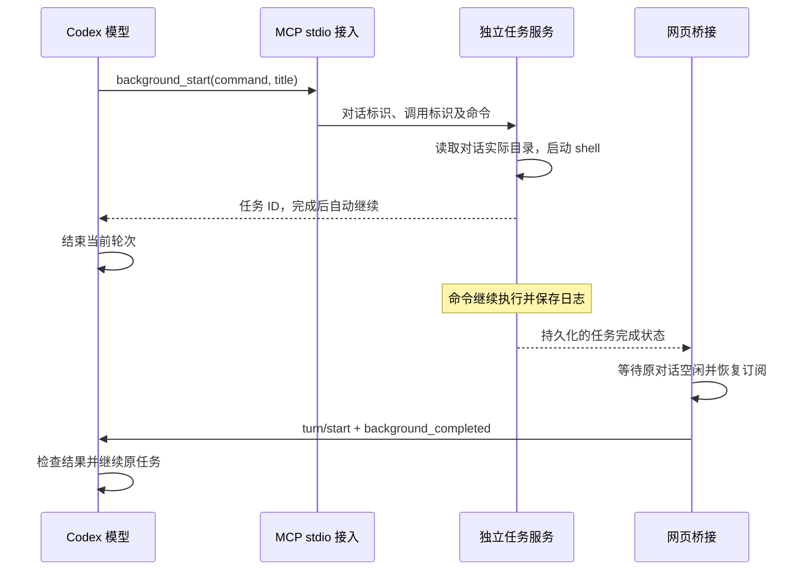

# MCP 后台任务

后台任务用于有明确结束条件的长命令。模型启动命令后可以结束当前轮次，任务由本机独立进程继续执行；网页桥接在任务结束后恢复原对话，让模型处理退出结果。网页刷新、浏览器关闭及对话卸载均保留任务。

## 调用与进程归属



`background-client.mjs` 的 `backgroundConfig` 在 `thread/start`、`thread/resume` 和 `thread/fork` 时合并 MCP 配置，保留调用方的其他配置。服务名固定为 `codex_web_background`，入口为 `background-mcp.mjs`，使用安装时的 Node.js 与脚本绝对路径。工具可加入已有对话，Codex 的全局配置文件保持原有内容。

模型可调用四个工具：

- `background_start`：接收 shell 命令、简短名称和可选时限，返回任务 ID 与自动继续约定。
- `background_read`：读取当前对话的任务及日志；缺少偏移量时返回末尾，显式偏移量按字节分页。模型读取已结束任务后，服务将其结果记为已读取。
- `background_list`：列出当前对话的后台任务。
- `background_cancel`：停止指定任务的进程组，并关闭该结果的自动继续。

对话 ID 与调用 ID 来自 Codex 在 MCP `tools/call._meta` 中附加的 `threadId` 和 `callId`。任务服务通过独立只读连接调用 `thread/read`，取得该对话的实际 `cwd`。模型参数仅描述命令、名称、时限和任务 ID。启动请求按对话 ID 与调用 ID 去重，同一调用重试返回原任务。

## 任务服务与数据

`background-daemon.mjs` 提供仅监听 `127.0.0.1` 的内部 HTTP 接口，注册文件 `service.json` 保存临时端口、随机令牌和 PID。MCP 接入和网页桥接通过 `backgroundRequest` 调用，内部请求携带令牌。注册文件和任务文件使用当前用户专用权限。

目录由实际 `CODEX_HOME` 与后端 WebSocket 地址的 SHA-256 前 16 位组成：`CODEX_HOME/codex-web/background/地址摘要/`。每个任务保存命令、实际目录、执行状态、时间、退出码和日志，完成通知另存为批次文件。文件按键串行写入，以临时文件加原子重命名更新；日志文件单独追加。

`background-jobs.mjs` 使用当前任务进程的 `SHELL`，环境缺失时使用系统账户 shell，再回退到 `/bin/sh`，以 `-lc` 启动命令。输入来自空设备，标准输出和错误输出写入同一日志。每个任务最多保存 64 MiB 日志；读取每段最多 32 KiB，并按完整 UTF-8 字符分段。取消或超时先向进程组发送 SIGTERM，两秒后发送 SIGKILL，清理同组后代。

systemd 安装为任务服务建立独立的 `codex-web-tasks.service`，网页服务通过 `Wants` 拉起它。网页桥接、MCP stdio 接入和 Codex 对话的退出各自释放自身资源，任务进程由任务服务持有。前台运行通过 MCP 首次调用按需启动任务服务进程。任务服务重启时，原运行记录转为中断并保留日志；完成记录及投递状态从磁盘恢复。

## 完成结果与对话续跑

`background-wake.mjs` 在桥接内每秒读取任务快照。对话有运行中的轮次、整理任务、文件撤销或尚未结束的写入请求时，结果保持等待。空闲后，每批最多合并八个结果，取得具有所有者标识的投递租约，再恢复原对话；恢复、提交期间保护其订阅。后端处于对话关闭窗口时，恢复操作每 100 毫秒重试一次，最多 50 次。

提交参数为 `turn/start` 的空 `input`、`turnTrigger: "background_task"` 及 `toolOutput: { name: "background_completed", output }`。JSON 结果包含稳定的 `notification_id`、任务标识、退出状态、耗时和日志末尾。每项日志最多 8000 个 Unicode 字符，每批总计最多 24000 个；命令摘要最多 2000 个字符。后续模型使用 `background_read` 取得更多日志。

投递状态按以下流程保存：

```text
任务完成 → pending → preparing → sending → accepted
                          │          │
                     恢复失败     响应丢失
                          ↓          ↓
                       pending    uncertain → 读取历史核对

模型已读取结果 → consumed
取消任务或归档对话 → suppressed
```

准备阶段租约每 30 秒更新，其他桥接可在原租约 120 秒未更新后接管。已受理批次保持受理状态；取消及已读取结果在提交前从批次中排除。恢复失败或后端明确拒绝请求时，十秒后可重新尝试。

发送后遇到连接中断或响应超时，结果记为 `uncertain`。桥接遍历原对话的完整轮次分页，查找 `functionCallOutput` 中名称为 `background_completed` 且 `notification_id` 匹配的记录；找到后记为已受理。等待核对期间每 30 秒检查一次；历史尚未确认时保留待核对状态，由用户显式执行“检查并重试继续”重新检查并提交。任务服务启动时将遗留的 `sending` 转为待核对，将未提交的 `preparing` 转为等待。

归档通知关闭该对话任务的自动继续，已离线发生的归档也通过存储路径或恢复接口返回的归档状态识别；删除通知同时停止所属进程。模型通过 MCP 读过最终结果后，结果标记为 `consumed`，后续周期检查保留该记录。界面读取日志用于展示，继续保留自动投递。

## 网页状态与验证

桥接通过 `lan/state.backgroundJobs` 与 `lan/backgroundJobs` 广播快照。页面使用 `lan/background/list`、`read`、`cancel` 和 `retry` 查看与管理任务；日志和取消操作在 Codex 后端暂时断线时仍可访问本机任务服务。状态按对话 ID 隔离，任务面板使用现有右侧卡片，底部输入框和草稿保留原状态。完成工具结果在工作过程中显示中文任务名称、状态、退出码与输出。

- `server/tests/background-jobs.test.mjs`：任务去重、UTF-8 日志分页、失败与超时、进程树取消、服务停止与恢复、投递租约、合并及结果核对。
- `server/tests/background-bridge.test.mjs`：真实 MCP stdio 入口与独立任务进程，关闭页面和桥接重启后的执行、恢复与重复投递检查。
- `tests/components/background-jobs.mjs`：任务管理、失败重试、迟到日志隔离、对话切换、草稿与附件保留。
- `npm run test:background:codex`：真实 Codex app-server 与本机 Responses 模拟服务，使用临时目录验证旧对话挂载、轮次结束、卸载、页面关闭和自动续跑。证据保存在 `.cache/background-codex/evidence.json`。
- `CHROME_PATH=/path/to/chromium npm run test:background:browser`：先构建前端，使用隔离数据操作真实浏览器，保存启动前后、失败、取消、刷新和重试状态，以及桌面和窄屏的深浅主题截图。
